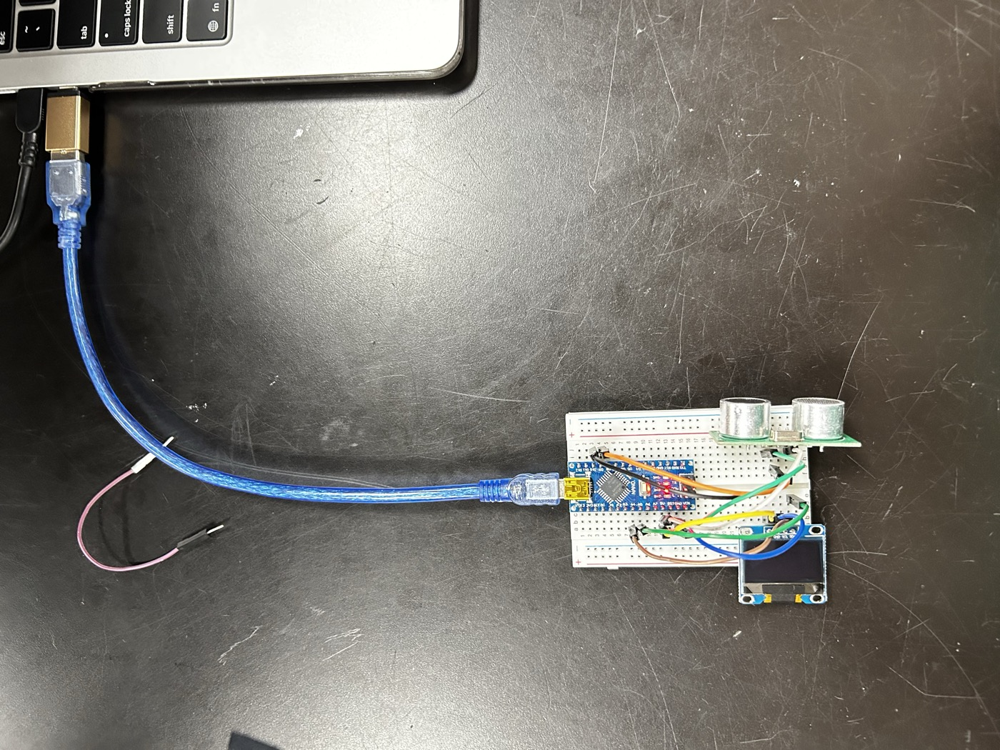
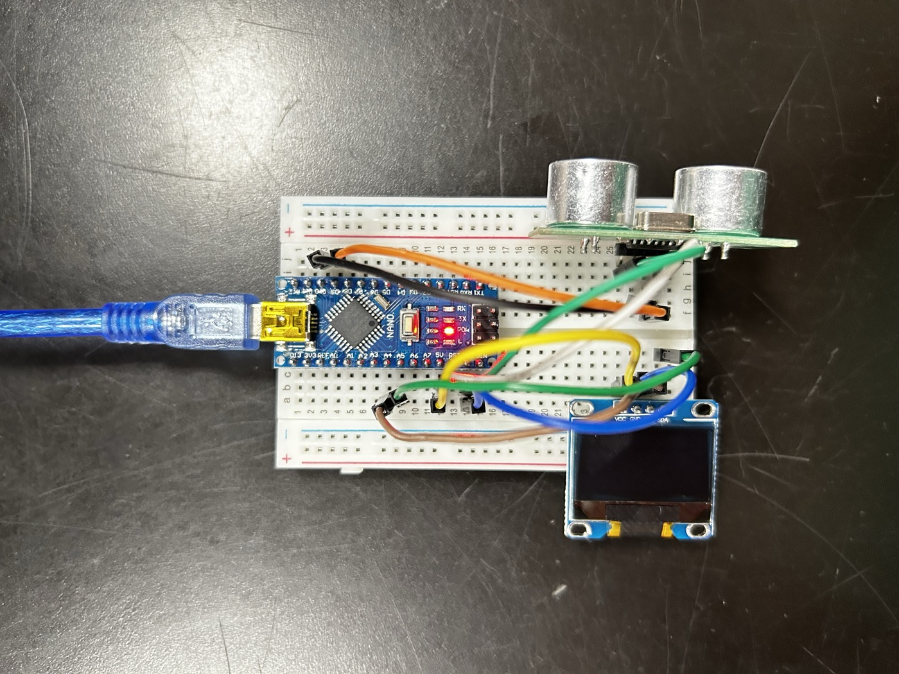

# Sensor Layer starter

Computer Coding Studio, fall 2026. The camera, the model, one worked signal and a fake sensor, so your pair starts from a piece that already runs.

**Live:** https://flyinthelyceum.github.io/sensor-layer-starter/ (click Start the camera; press D, B, V)

## Make it yours

1. Click **Use this template**, then **Create a new repository**, under one partner's account. Add the other partner as a collaborator (Settings, Collaborators).
2. Both partners clone it, open it in VS Code, and run it with a local server. Live Server works, or in the terminal: `python3 -m http.server`, then open `http://localhost:8000`. Opening `index.html` straight from the Finder will not reach the camera.
3. Turn on GitHub Pages: Settings, Pages, branch `main`, folder `/ (root)`. That address is the live URL you submit.

## The files

| File | Job | Who edits it |
|---|---|---|
| `table.js` | Your State Table, row for row: the signals, the states, the rules, the holds | both of you, first |
| `sense.js` | Reads the camera, turns readings into signals, applies the table, writes `window.sense` | each partner, your own signal |
| `piece.js` | Reads `window.sense` every frame and answers | both of you |
| `fake-sense.js` | Writes the same object with no camera: number keys set the state, the mouse sets the signals | only if your signal names change |
| `index.html` | Loads them in order | rarely |

## The object

```js
window.sense = {
  state: 'here',                          // one word from your State Table
  signals: { present: 0.98, open: 0.02 }, // each a number from 0 to 1
  since: 184203.5                         // performance.now() when this state began
};
```

`piece.js` reads this and nothing else. It never touches the camera. That is why the piece keeps running on `fake-sense.js` when no camera is there, and why a scene you build in November can run off the sensor you build now.

## Adding your signal

1. Add its name to `signals` in `table.js`.
2. Add a function with the same name to `SIGNALS` in `sense.js`. It gets one frame's result and returns a number from 0 to 1. There are two patterns in the comments there: one of the 52 named scores from the lab, or geometry from the 478 points.
3. Use it in a rule in `table.js`. Press **D** to watch the number while you set the threshold. Thresholds that move go in your break log.

## Keys

- **D**: the object `piece.js` reads, live
- **B**: all 52 named scores, to find the one you measured in the Make a Face lab
- **V**: the camera, small, in the corner
- **1, 2, 3 …** and the **mouse**: drive the fake sensor before the camera starts

## When Start does nothing useful

If the readout says the face library did not load, the school network is blocking `cdn.jsdelivr.net`. Press **D** and keep going on the fake sensor: the piece reads the same object either way. A new state you add to `table.js` gets a bright colour of its own in `piece.js` until you give it one.

## Bench pairs: an Arduino instead of the camera

The bench track swaps the sense layer and nothing else. `piece.js` and `fake-sense.js` stay exactly as they are. The wiring, a photo of a working build and upload fixes are in `bench/README.md`.

1. Build the circuit and flash `bench/bench.ino` from the Arduino IDE. It prints one line per reading, like `cm 42.5`. Check it in the IDE's Serial Monitor at 115200, then **close the Serial Monitor**: only one program can hold the port.
2. Open **`bench.html`** instead of `index.html`, on localhost in **Chrome**. It loads the bench table and the serial sense layer; nothing to edit.
3. Click **Connect the Arduino** and pick the board. Press **D** to see the raw line and your signals.
4. Your State Table lives in **`bench/table-bench.js`** (same format as `table.js`). Your signal is a function in `SIGNALS` in `bench/sense-serial.js`: it gets the latest reading (`{ cm: 42.5 }`) and returns 0 to 1. Add the sensor to the sketch's printed line, then its function, then its name in `bench/table-bench.js`.

## What stays in the browser

Nothing saves a frame or a landmark list. The model downloads once when you click Start; after that the Network panel stays quiet. Keep it that way: no `localStorage` of readings, no uploads, no screenshots of the camera image in the repo. Screenshots for your break log show the piece or the D readout.

The instrument is MediaPipe Face Landmarker, pinned to version 1.1.1, the same one the Make a Face lab used.

## Credits

- Fordham Wong: the wiring and reading of the HC-SR04 (`near`, `present`), and the response in `piece.js`
- Ethan Takher: the PIR sensor (`still`)

Sensor: HC-SR04 ultrasonic distance sensor and HC-SR501 PIR motion sensor

Live: https://fwong29.github.io/team-repository/

## Break log

- Fri Oct 23 (7eec54b): Nano upload hung / processor setting didn't match the bootloader / switched to ATmega328P (Old Bootloader)
- Fri Oct 23 (7eec54b): Serial Monitor showed garbage characters / monitor was at 9600 baud, sketch sends 115200 / set the monitor to 115200
- Mon Oct 26 (bdde448): the screen stayed black while the state read close / the old piece.js was not drawing / replaced it with a gradient version that follows near

## Build





## Sensor and wiring

Arduino Nano with two sensors on one breadboard. Photos are in the Build section above.

| Part | Pin | Nano pin |
|---|---|---|
| HC-SR04 | VCC | 5V |
| HC-SR04 | GND | GND |
| HC-SR04 | TRIG | D9 |
| HC-SR04 | ECHO | D10 |
| PIR (HC-SR501) | VCC | 5V |
| PIR (HC-SR501) | GND | GND |
| PIR (HC-SR501) | OUT | D2 |

Sketch: `bench/bench.ino`. The browser side is `bench.html`, with the rows in `bench/table-bench.js`.

## The rule

Three readings from the HC-SR04:

- Nothing happening: 400 cm (no echo comes back)
- A little (someone about 1 m away): 100 cm
- A lot (a hand close to the sensor): 15 cm

The screen fades from black to white as the distance shrinks. Under about 38 cm it is nearly white and says NEAR, and with no one in range it is black and says FAR.