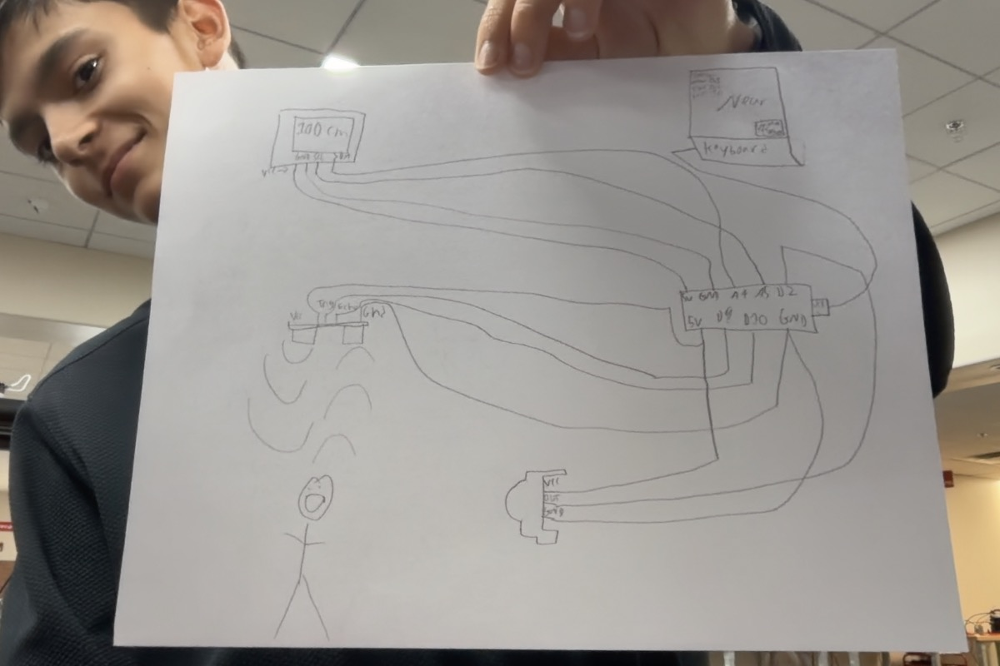
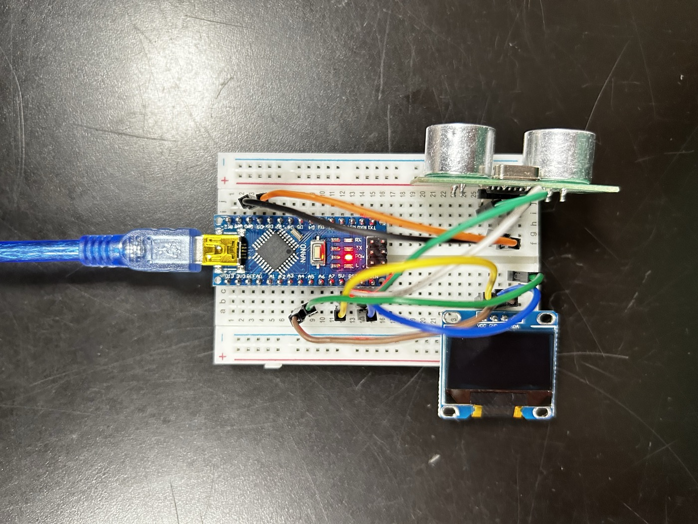

# It sees you. It names you. It acts.

Ford Wong and Ethan Takher · Computer Coding Studio, fall 2026 · v1.0

## The charter

```
It notices:    how near you are, in cm, and whether you are moving
It calls you:  hoverer, passerby, waiting, or nobody
It does:       says the name on its screen, in a word, and blinks that
               name's own pattern on its light
For them:      a visitor finds out what it called them without asking anyone,
               because the name is the biggest thing on the screen and the
               number it named them on is right underneath
To them:       it answers the nearest body in front of it and ignores the
               rest of the room
It refuses:    to count your visits, to save a reading, or to keep anything
               at all once it is unplugged
The tension:   the ultrasonic hears the nearest hard surface, not you, so a
               bag held out in front of you is named instead of you
```

## The State Table

The names run on the Nano. The rows are checked top to bottom, the first true
row wins, and a row has to stay true for its whole hold before the name
changes. Four seconds of motion is not yet a passerby if passerby's hold is
five: a rule that goes false partway through starts over.

| Name | Owner | Rule | Line | Gap | Hold |
|---|---|---|---|---|---|
| `hoverer` | Ford | closer than the near line | 40 cm | 8 cm | 0.6 s |
| `passerby` | Ethan | in range, and the PIR sees motion | motion 0.60 | 0.25 | 1.0 s |
| `waiting` | ours | in range, and the PIR sees no motion | motion 0.35 | 0.25 | 1.5 s |
| `nobody` | ours | nothing in range | 150 cm | 20 cm | 2.0 s |

**The gap is what keeps it steady.** A line on its own flickers: a hand sitting
at exactly 40 cm renames the piece on every reading. Each line here has a gap
on the far side of it, so `hoverer` starts at 40 cm but does not let go until
48, and `nobody` starts past 150 cm but does not let go until you come back
inside 170. Between 0.35 and 0.60 on the motion reading no row is true at all,
and the piece keeps the name it already has. On top of that the distance is the
median of the last three echoes, so one missed echo renames nobody.

**The holds, and why each is what it is.** `hoverer` gets 0.6 s, the shortest,
because that is the row a visitor is standing in front of on purpose and it
should answer almost at once. `passerby` gets 1.0 s so that walking past the
doorway is not enough to get named. `waiting` gets 1.5 s because the PIR holds
its output high for seconds after movement stops, and the hold keeps the name
from flicking on in the gap between two steps. `nobody` gets 2.0 s, the
longest, because a single bad reading should never read as everybody leaving.

**Each name answers differently**, so a stranger can tell them apart without
being told:

| Name | The screen | The light |
|---|---|---|
| `hoverer` | the word knocked out of a solid white bar, the distance in big digits | on, and it stays on |
| `passerby` | a dot running left to right along the bottom: the trace movement leaves | fast flicker |
| `waiting` | a row of still ticks, and the seconds you have been still | two short blinks, then a rest |
| `nobody` | `---` where the number was, one dot drifting slowly, the word `waiting` | one short blink every three seconds |

While a new name is waiting out its hold the screen says so — `PASSERBY?` and a
bar filling — so the pause reads as the piece deciding, not as lag.

The same four names and the same numbers are in `bench/table-bench.js` for the
laptop view. Change a number in one and you have to change it in the other.

## The sensors and the wiring

An Arduino Nano, two sensors and an OLED on one breadboard.

| Part | Pin | Nano pin | Whose |
|---|---|---|---|
| HC-SR04 / US-025A ultrasonic | VCC | 5V | Ford |
| HC-SR04 / US-025A ultrasonic | GND | GND | Ford |
| HC-SR04 / US-025A ultrasonic | TRIG | D9 | Ford |
| HC-SR04 / US-025A ultrasonic | ECHO | D10 | Ford |
| PIR motion (HC-SR501) | VCC | 5V | Ethan |
| PIR motion (HC-SR501) | GND | GND | Ethan |
| PIR motion (HC-SR501) | OUT | D2 | Ethan |
| OLED (SSD1306, I2C) | VCC | 5V | both |
| OLED (SSD1306, I2C) | GND | GND | both |
| OLED (SSD1306, I2C) | SDA | A4 | both |
| OLED (SSD1306, I2C) | SCL | A5 | both |

The name's light is the Nano's own LED on D13, so it needs no wire. A buzzer on
D8 is optional and off: `#define USE_BUZZER 1` in the sketch turns it on.

Aim the ultrasonic off the edge of the desk or slightly up. Flat on the desk it
hears the desk and reads a few centimetres with nobody there.



*The drawing we worked from.*




*Wiring the board, before the PIR went on and before the sketch was flashed —
which is why the screen is dark in both. A photo of the finished piece on its
own power, naming someone, goes here: `img/finished-piece.jpg`.*

## How to run it

1. Plug the Nano into a 5V USB wall charger or a power bank. Nothing else — no laptop, no Serial Monitor.
2. Wait out the minute the screen counts down while the PIR warms up.
3. Stand in front of it. The top line of the screen is what it calls you.

To change it: flash `bench/bench.ino` from the Arduino IDE (Board: Arduino
Nano; it needs the **U8g2** library). To watch the table's holds without a
board, run `bench/test/run.sh`. The laptop view is `bench.html`, served on
localhost in Chrome — an extra, never the piece.

It still prints one line per reading over USB as a word and a number, so
`bench.html` and anything else can read it in December:

```
cm 23.6 motion 1 held 2.3 name HOVERER
```

## Who it names wrongly

- **A coat swallows the echo.** The ultrasonic needs a hard surface to bounce
  off. Soft clothing, long hair or an open jacket can come back as no echo at
  all, so someone standing right there gets called `nobody`.
- **It names the nearest thing, not the nearest person.** A bag, a laptop lid
  or a hand held out in front of you is what it measures. Whoever is actually
  there gets the name their luggage earned.
- **It is aimed at standing height.** The cone is about 30° wide. Someone
  seated, someone short, or someone in a wheelchair can sit under it and never
  be seen, which the piece reports as an empty room.
- **The PIR reads heat and movement, not people.** A radiator, a laptop fan or
  sunlight moving across the desk can hold `passerby` on with nobody there, and
  it cannot see through glass at all.
- **It cannot count.** Four people in front of it get one name, decided by
  whoever stands closest.
- **Holding still makes you furniture.** Stay still long enough and the PIR
  drops you to `waiting`, which is the piece saying you stopped, not that you
  left — but it looks the same as being ignored.

It keeps none of this. Nothing is written down, nothing is counted, and
unplugging it forgets everything.

## Break log

- Fri Oct 23 (`7eec54b`): Nano upload hung / processor setting didn't match the bootloader / switched to ATmega328P (Old Bootloader)
- Fri Oct 23 (`7eec54b`): Serial Monitor showed garbage characters / monitor was at 9600 baud, sketch sends 115200 / set the monitor to 115200
- Mon Oct 26 (`bdde448`): the screen stayed black while the state read close / the old `piece.js` was not drawing / replaced it with a gradient version that follows `near`
- Tue Oct 27 (`40901ce`): the OLED stayed blank even though the I2C scan found it at 0x3C / the Adafruit SSD1306 library would not draw on this module / switched to the U8g2 library with the SSD1306 driver
- Mon Nov 16 (`417c101`): the OLED only worked while the laptop was attached / the Nano was drawing its power over the laptop's USB / ran it from a 5V wall charger instead
- Wed Nov 18 (`58926ed`): unplugging the laptop stopped the piece naming anyone / the State Table lived in the browser and the sketch only printed numbers / moved all four names, their holds and their lines into `bench.ino`, so the Nano names you on its own
- Wed Nov 18 (`3eb900b`): a reading jittering between 39 and 41 cm renamed the piece on every pass / the lines had smoothing but no gap, so both sides of 40 cm were live at once / gave every line a gap and took the median of the last three echoes; the test harness now counts zero name changes across forty jitters
- Wed Nov 18 (`3eb900b`): the sketch built in the Arduino IDE but not in the test harness / the IDE writes function prototypes for you and plain C++ does not / declared the functions after the enum they take

## Credits

- **Ford Wong** owns **`hoverer`**: the HC-SR04 ultrasonic, the cm reading and
  its median, the 40 cm line and its 8 cm gap, the naming loop and the screen.
- **Ethan Takher** owns **`passerby`**: the HC-SR501 PIR, the motion reading,
  the 0.60 line it crosses, and the warm-up minute it needs before it is worth
  believing.
- **`waiting` and `nobody` are ours together.** `waiting` is the row that needs
  both sensors at once — in range from Ford's ultrasonic, gone quiet on Ethan's
  PIR — and `nobody` is the row that catches everything the other three miss.

Sensors: HC-SR04 / US-025A ultrasonic distance sensor, HC-SR501 PIR motion
sensor. Screen: SSD1306 OLED, 128 × 64, over I2C, with the U8g2 library.
Built on the Sensor Layer starter, which gave us `piece.js`, `fake-sense.js`
and the shape of the State Table.

Laptop view: https://fwong29.github.io/team-repository/ — this repo stays
public through December.
