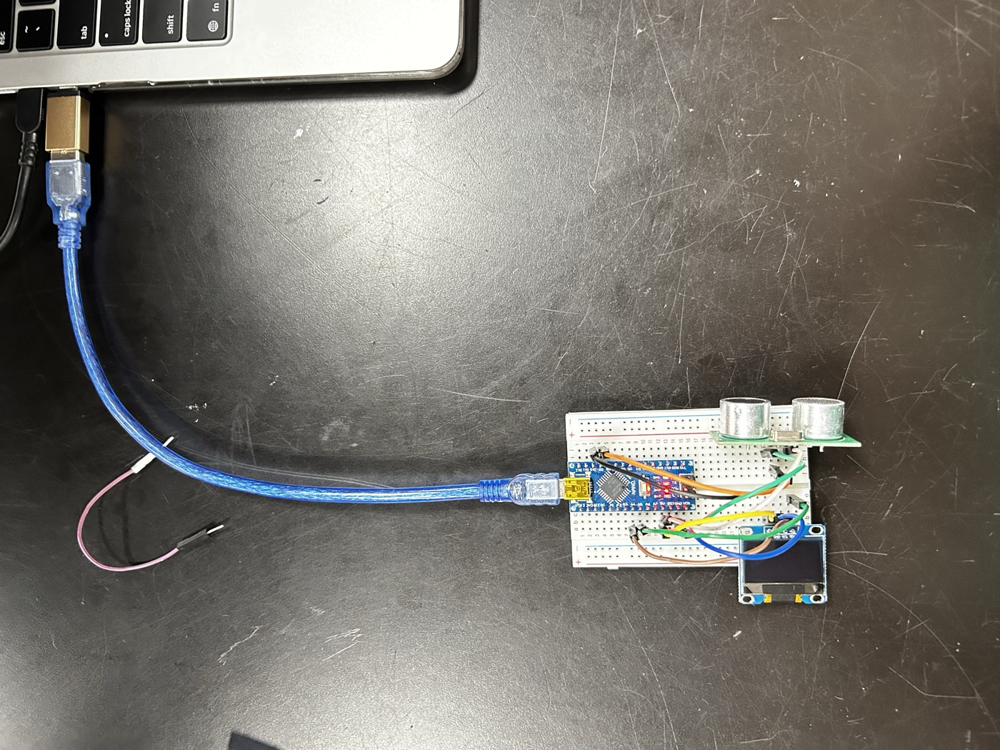

# It sees you. It names you. It acts.

Ford Wong and Ethan Takher · Computer Coding Studio, fall 2026 · v1.0

## The charter

```
It notices:    how near you are, in cm, and whether you are moving
It calls you:  hoverer, passerby, waiting, or nobody
It does:       shows how far away you are and how fast you are coming, in
               centimetres and centimetres a second, and blinks the name it
               has given you on its light
For them:      a visitor reads the two numbers it is judging them on straight
               off the screen, and watches them move as they move
To them:       it answers the nearest body in front of it and ignores the
               rest of the room
It refuses:    to count your visits, to save a reading, or to keep anything
               at all once it is unplugged
The tension:   the ultrasonic hears the nearest hard surface, not you, so a
               bag held out in front of you is named instead of you
```

## The State Table

The names run on the Nano. The rows are checked top to bottom, the first true
row wins, and a row has to stay true for its whole hold before the name
changes. Four seconds of motion is not yet a passerby if passerby's hold is
five: a rule that goes false partway through starts over.

| Name | Owner | Rule | Line | Gap | Hold |
|---|---|---|---|---|---|
| `hoverer` | Ford | closer than the near line | 20 cm | 8 cm | 0.6 s |
| `passerby` | Ethan | in range, and the PIR sees motion | motion 0.60 | 0.25 | 1.0 s |
| `waiting` | ours | in range, and the PIR sees no motion | motion 0.35 | 0.25 | 1.5 s |
| `nobody` | ours | nothing in range | 150 cm | 20 cm | 2.0 s |

**The gap is what keeps it steady.** A line on its own flickers: a hand sitting
at exactly 20 cm renames the piece on every reading. Each line here has a gap
on the far side of it, so `hoverer` starts at 20 cm but does not let go until
28, and `nobody` starts past 150 cm but does not let go until you come back
inside 170. Between 0.35 and 0.60 on the motion reading no row is true at all,
and the piece keeps the name it already has. On top of that the distance is the
median of the last three echoes, so one missed echo renames nobody.

**What 20 cm means.** The line was 40 cm and is now half that, which changes
what the name is about: at 40 cm a person standing close enough to read the
screen was a `hoverer`, and at 20 cm it takes a hand put there deliberately.
The name got narrower and more certain. Everyone standing at a normal reading
distance is a `waiting` or a `passerby` now. The gap stays at 8 cm, because
the sensor's wobble is about three centimetres whatever the distance — it is
an amount of noise, not a proportion of the reading.

**The holds, and why each is what it is.** `hoverer` gets 0.6 s, the shortest,
because that is the row a visitor is standing in front of on purpose and it
should answer almost at once. `passerby` gets 1.0 s so that walking past the
doorway is not enough to get named. `waiting` gets 1.5 s because the PIR holds
its output high for seconds after movement stops, and the hold keeps the name
from flicking on in the gap between two steps. `nobody` gets 2.0 s, the
longest, because a single bad reading should never read as everybody leaving.

**The screen shows two readings and nothing else**: how far away you are, and
how fast you are coming. Both as big as the panel allows, because they are
meant to be read from where a visitor is standing rather than leaned over.

```
102 cm
 40 cm/s closer
```

With nothing in range it reads `---` and `nobody in range`.

**The name is on the light.** It is still worked out every frame, with its own
rules and its own hold; it is the pattern the Nano's LED blinks, which is
readable across a room with the screen facing away:

| Name | The light |
|---|---|
| `hoverer` | on, and it stays on |
| `passerby` | fast flicker |
| `waiting` | two short blinks, then a rest |
| `nobody` | one short blink every three seconds |

This is the trade the piece makes: the screen stopped being the thing that
names you and became the instrument you read. A visitor can see exactly what
it measures about them; to know what it decided to *call* them, they have to
read the light.

**The numbers hold still long enough to read.** The sensor talks twenty times a second and
no two readings agree, so left alone the digits strobe and the speed is
unreadable. Three things stop that, and they are the same three ideas as the
rest of the piece:

| | What it does |
|---|---|
| a baseline | speed is measured against where you were half a second ago, not against the last reading, which is mostly noise |
| a step | distance shows to the nearest 2 cm and speed to the nearest 5 cm/s, so small wobble changes nothing |
| a hold | a reading has to sit outside that step for a quarter of a second together before the digits move, and nothing on the screen changes more than three times a second |

The speed word has a gap in it as well: it takes 10 cm/s to start reading as
movement and keeps reading as movement until you drop under 6, so walking at
the edge of the two does not strobe. With nobody in range there is no speed to
report and the line stays empty.

A hand held still with 3 cm of sensor wobble moves the raw number about 176
times in ten seconds. It moves the number on the screen zero times, and the
speed still reads `closer 40 cm/s` when someone really walks in. Both are
checked in `bench/test/run.sh`.

The same four names and the same numbers are in `bench/table-bench.js` for the
laptop view. Change a number in one and you have to change it in the other.

## The sensors and the wiring

An Arduino Nano, two sensors and an OLED on one breadboard.

| Part | Pin | Nano pin | Whose |
|---|---|---|---|
| HC-SR04 / US-025A ultrasonic | VCC | 5V | Ford |
| HC-SR04 / US-025A ultrasonic | GND | GND | Ford |
| HC-SR04 / US-025A ultrasonic | TRIG | D9 | Ford |
| HC-SR04 / US-025A ultrasonic | ECHO | D10 | Ford |
| PIR motion (HC-SR501) | VCC | 5V | Ethan |
| PIR motion (HC-SR501) | GND | GND | Ethan |
| PIR motion (HC-SR501) | OUT | D2 | Ethan |
| OLED (SSD1306, I2C) | VCC | 5V | both |
| OLED (SSD1306, I2C) | GND | GND | both |
| OLED (SSD1306, I2C) | SDA | A4 | both |
| OLED (SSD1306, I2C) | SCL | A5 | both |

The name's light is the Nano's own LED on D13, so it needs no wire. A buzzer on
D8 is optional and off: `#define USE_BUZZER 1` in the sketch turns it on.

Aim the ultrasonic off the edge of the desk or slightly up. Flat on the desk it
hears the desk and reads a few centimetres with nobody there.

Three readings to recognise, on the screen or in the USB line:

- **400 cm** — nothing happening. No echo came back inside 30 ms, so there is
  nothing in range. The screen shows `---` rather than the number.
- **100 cm** — a little. Somebody about a metre away, in range.
- **15 cm** — a lot. A hand close to the sensor.


*The drawing we worked from.*




*Wiring the board, before the PIR went on and before the sketch was flashed —
which is why the screen is dark in both. A photo of the finished piece on its
own power, naming someone, goes here: `img/finished-piece.jpg`.*

## How to run it

1. Plug the Nano into a 5V USB wall charger or a power bank. Nothing else — no laptop, no Serial Monitor.
2. Wait out the minute the screen counts down while the PIR warms up.
3. Stand in front of it. The top line of the screen is what it calls you.

To change it: flash `bench/bench.ino` from the Arduino IDE (Board: Arduino
Nano; it needs the **U8g2** library). To check it without a board, run
`bench/test/run.sh`: it runs the table on a fake clock and a fake sensor, and
measures where every row of every screen lands, so nothing is drawn off the
128 × 64 panel and no two rows of text sit on top of each other. Add
`--picture` and it draws the screens to `bench/test/screen-preview.png` as
well. None of it says anything about the wiring. The laptop view is `bench.html`, served on
localhost in Chrome — an extra, never the piece.

It still prints one line per reading over USB as a word and a number, so
`bench.html` and anything else can read it in December. The line carries the
raw reading, not the steadied one, so nothing downstream loses detail:

```
cm 14.2 motion 1 speed 12.4 held 2.3 name HOVERER
```

## Who it names wrongly

- **A coat swallows the echo.** The ultrasonic needs a hard surface to bounce
  off. Soft clothing, long hair or an open jacket can come back as no echo at
  all, so someone standing right there gets called `nobody`.
- **It names the nearest thing, not the nearest person.** A bag, a laptop lid
  or a hand held out in front of you is what it measures. Whoever is actually
  there gets the name their luggage earned.
- **It is aimed at standing height.** The cone is about 30° wide. Someone
  seated, someone short, or someone in a wheelchair can sit under it and never
  be seen, which the piece reports as an empty room.
- **The PIR reads heat and movement, not people.** A radiator, a laptop fan or
  sunlight moving across the desk can hold `passerby` on with nobody there, and
  it cannot see through glass at all.
- **It cannot count.** Four people in front of it get one name, decided by
  whoever stands closest.
- **Holding still makes you furniture.** Stay still long enough and the PIR
  drops you to `waiting`, which is the piece saying you stopped, not that you
  left — but it looks the same as being ignored.

It keeps none of this. Nothing is written down, nothing is counted, and
unplugging it forgets everything.

## Break log

- Mon Nov 23 (`a55ffd7`): the harness reported 26 passes for a sketch that did not compile / `run.sh` piped g++ through `grep ... || true`, which hid the error and then ran the binary from the last build that worked / build into a fresh binary, stop on a failure, and say `nothing was run`. It surfaced when the sketch moved to the 2-page U8g2 constructor and the test stub still knew only the full-frame one — every "all passing" between those two changes was reporting on old code.
- Mon Nov 23 (`9c1f4fb`): the sketch would not upload at all — `data section exceeds available space in board` / global variables came to 2083 bytes and the Nano has 2048: U8g2's full-frame constructor keeps the whole 128 x 64 screen, 1024 bytes, in RAM, and every string literal was sitting in RAM beside it / switched to the 2-page constructor, which keeps 256 bytes and redraws in four passes, and wrapped every literal in `F()` so it stays in flash
- Fri Oct 23 (`7eec54b`): Nano upload hung / processor setting didn't match the bootloader / switched to ATmega328P (Old Bootloader)
- Fri Oct 23 (`7eec54b`): Serial Monitor showed garbage characters / monitor was at 9600 baud, sketch sends 115200 / set the monitor to 115200
- Mon Oct 26 (`bdde448`): the screen stayed black while the state read close / the old `piece.js` was not drawing / replaced it with a gradient version that follows `near`
- Tue Oct 27 (`40901ce`): the OLED stayed blank even though the I2C scan found it at 0x3C / the Adafruit SSD1306 library would not draw on this module / switched to the U8g2 library with the SSD1306 driver
- Mon Nov 16 (`417c101`): the OLED only worked while the laptop was attached / the Nano was drawing its power over the laptop's USB / ran it from a 5V wall charger instead
- Wed Nov 18 (`58926ed`): unplugging the laptop stopped the piece naming anyone / the State Table lived in the browser and the sketch only printed numbers / moved all four names, their holds and their lines into `bench.ino`, so the Nano names you on its own
- Wed Nov 18 (`3eb900b`): a reading jittering between 39 and 41 cm renamed the piece on every pass / the lines had smoothing but no gap, so both sides of 40 cm were live at once / gave every line a gap and took the median of the last three echoes; the test harness now counts zero name changes across forty jitters
- Fri Nov 20 (`bc2164a`): the screen was busy enough that the two readings a visitor actually wants were the smallest things on it / it was carrying the name, the number, the speed, a per-name strip and a hold bar in 128 x 64 / cut it to the two readings, how far and how fast, both as big as the panel allows, and moved the name onto the light
- Fri Nov 20 (`2ab9cb3`): the warm-up screen's second line ran ten pixels off the right edge, and it shipped in v1.0 / "the motion sensor needs" is 23 characters and the 6x10 font fits 21 across 128 px / split the line, and wrote `bench/test/screen-check` so the panel's edges are measured instead of guessed. It is the first screen anybody sees and nobody had seen it.
- Fri Nov 20 (`2ab9cb3`): the g in "waiting" was cut off the bottom of the nobody screen / the bottom row sat on baseline 63 and a descender needs two rows under it / moved the bottom row to 61, and kept the drifting dot clear of the word so it does not look like a fault
- Fri Nov 20 (`5033926`): the speed of approach was gone, and the distance digits flickered too fast to read / moving the naming onto the Nano had dropped the cm/s readout, and the digits were redrawn from the raw reading twenty times a second / measured speed against where you were half a second ago instead of against the last reading, put both numbers on a step and a quarter-second hold, and gave the speed word a gap like the names have. Holding a hand still moves the shown number 0 times in ten seconds, where the raw one moves 176.
- Wed Nov 18 (`3eb900b`): the sketch built in the Arduino IDE but not in the test harness / the IDE writes function prototypes for you and plain C++ does not / declared the functions after the enum they take

## Credits

- **Ford Wong** owns **`hoverer`**: the HC-SR04 ultrasonic, the cm reading and
  its median, the 20 cm line and its 8 cm gap, the naming loop and the screen.
- **Ethan Takher** owns **`passerby`**: the HC-SR501 PIR, the motion reading,
  the 0.60 line it crosses, and the warm-up minute it needs before it is worth
  believing.
- **`waiting` and `nobody` are ours together.** `waiting` is the row that needs
  both sensors at once — in range from Ford's ultrasonic, gone quiet on Ethan's
  PIR — and `nobody` is the row that catches everything the other three miss.

Sensors: HC-SR04 / US-025A ultrasonic distance sensor, HC-SR501 PIR motion
sensor. Screen: SSD1306 OLED, 128 × 64, over I2C, with the U8g2 library.
Built on the Sensor Layer starter, which gave us `piece.js`, `fake-sense.js`
and the shape of the State Table.

Laptop view: https://fwong29.github.io/team-repository/ — this repo stays
public through December.
